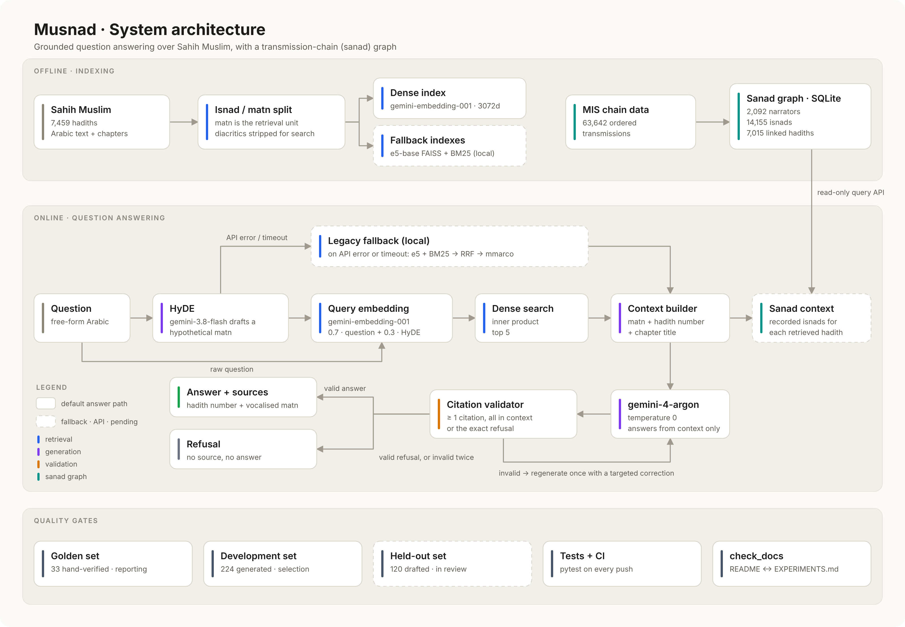

# Musnad — Agentic GraphRAG over Sahih Muslim

**The upgraded default reaches 100% hit@5 on 27 hand-verified questions, averages 96.3% correct citations (`156/162`) and 83.3% correct refusals (`15/18`) across 6 text runs with SQLite sanad chains attached on 95.9% of citations (`211/220`), and answers 100.0% (`25/25`) on frozen chain evaluation with `0` hallucinated narrators.**

Grounded Arabic question answering over Sahih Muslim, combining dense semantic matn retrieval (`gemini-embedding-001` + HyDE), a hybrid Arabic intent router (`v3`), a tool-calling chain agent (`gemini-4-argon`), and a deterministic transmission-chain (sanad) graph in SQLite (`sanad_graph.sqlite`).

> «مُسنَد» يوجّه أسئلة صحيح مسلم تلقائيًا (`MUSNAD_AGENT=auto`): يمرّ سؤال المتن والفقه عبر مسار الاسترجاع الأحادي السريع ويُرفق تحت كل حديث مستشهد به سنده من قاعدة البيانات، بينما يتولّى الوكيل أسئلة الرواة والأسانيد عبر أدوات البحث وفحص السند دون اختلاق أي اسم راوٍ.

[](https://github.com/asmaasamyhagag22-design/Hadith-Agentic-GraphRAG/actions/workflows/tests.yml)


---

## Demo

Output captured live from `uv run python -m src.answer` in default `auto` mode (`data/processed/auto_smoke_cli.txt`): one **text** question routed to single-turn RAG with its attached SQLite sanad chain, and one **chain** question routed to the tool-calling agent.

```text
================================================================================
ما جزاء من صام رمضان إيماناً واحتساباً؟

Answer:
جزاء من صام رمضان إيماناً واحتساباً أن يُغفر له ما تقدم من ذنبه، كما قال رسول الله صلى الله عليه وسلم: «مَنْ صَامَ رَمَضَانَ إِيمَانًا وَاحْتِسَابًا غُفِرَ لَهُ مَا تَقَدَّمَ مِنْ ذَنْبِهِ».

(المصدر: صحيح مسلم، حديث رقم 8950)

السند (من قاعدة بيانات السند):
- حديث رقم 8950: زهير بن حرب بن شداد أبو خثيمة ← معاذ بن هشام بن أبي عبد الله ← هشام بن أبي عبد الله الدستوائي ← يحيى بن أبي كثير الطائي ← أبو سلمة بن عبد الرحمن بن عوف ← أبو هريرة - عبد الرحمن بن صخر الدوسي

Retrieved Hadiths:
Rank: 1 | Hadith ID: 8950 | Chapter: كتاب صلاة المسافرين وقصرها
Rank: 2 | Hadith ID: 8948 | Chapter: كتاب صلاة المسافرين وقصرها
Rank: 3 | Hadith ID: 9867 | Chapter: كتاب الصيام
Rank: 4 | Hadith ID: 9868 | Chapter: كتاب الصيام
Rank: 5 | Hadith ID: 8949 | Chapter: كتاب صلاة المسافرين وقصرها
================================================================================
من هو الصحابي الذي روى حديث «كافل اليتيم أنا وهو كهاتين في الجنة»؟

Answer:
الصحابي الجليل الذي روى حديث «كَافِلُ الْيَتِيمِ لَهُ أَوْ لِغَيْرِهِ أَنَا وَهُوَ كَهَاتَيْنِ فِي الْجَنَّةِ» هو **أبو هريرة - عبد الرحمن بن صخر الدوسي** رضي الله عنه. (المصدر: صحيح مسلم، حديث رقم 14561)

السند (من قاعدة بيانات السند):
- حديث رقم 14561: زهير بن حرب بن شداد أبو خثيمة ← إسحاق بن عيسى بن نجيح ← مالك بن أنس بن مالك بن أبي عامر ← ثور بن زيد ← سالم أبو الغيث المدني مولى ← أبو هريرة - عبد الرحمن بن صخر الدوسي

Retrieved Hadiths:
Rank: 1 | Hadith ID: 14561 | Chapter: كتاب الزهد والرقائق
Rank: 2 | Hadith ID: 13809 | Chapter: كتاب البر والصلة والآداب
Rank: 3 | Hadith ID: 13575 | Chapter: كتاب فضائل الصحابة رضى الله تعالى عنهم
Rank: 4 | Hadith ID: 9534 | Chapter: كتاب الزكاة
Rank: 5 | Hadith ID: 13815 | Chapter: كتاب البر والصلة والآداب
```

---

## Architecture

<picture>
  <source media="(prefers-color-scheme: dark)" srcset="docs/assets/musnad-architecture-dark.png">
  
</picture>

The steps below describe the current `auto` request path: **Intent Router (`v3`) → (Single-Turn Text RAG + Sanad Attachment | Tool-Calling Chain Agent)**.

### Request lifecycle

1. **Intent classification (`src/router.py`, `v3`)** — When `MUSNAD_AGENT=auto` (default), deterministic Arabic regexes (`v2` fast path) check for explicit isnad/narrator cues (`0` API calls). On a fast-path miss, `v3` evaluates an L2-regularised logistic regression classifier (`threshold = 0.44`, `src/router_weights.npz`) over the normalised 3072-d `gemini-embedding-001` query vector (`UpgradedRetriever.get_query_embedding` caches it in `query_vec_cache`, incurring **`0` extra embedding API calls** and **`0.0645 ms`** median classifier overhead). If no embedding is available, `v3` falls back to `v2`.
2. **Query normalisation, HyDE blending, and dense matn retrieval (`1:0:0:0`)** — On the text path (or inside `search_hadith`), `UpgradedRetriever` strips diacritics, generates a short hypothetical Sahih Muslim *matn* with `gemini-3.8-flash` (`location="global"`, `thinking_level="LOW"`, `temperature=0`), embeds the query (reusing `query_vec_cache`) and HyDE text with `gemini-embedding-001` (`3072d`, `RETRIEVAL_QUERY`), blends `0.7 * q + 0.3 * HyDE_q`, and searches 7,110 diacritic-stripped matn chunks (`460` reference-only follow-ups excluded from `7,570` total chunks) by inner product (`src/retrieve.py`, `src/pipeline.py`). A failed or timed-out API request falls back automatically to `legacy` retrieval (`intfloat/multilingual-e5-base` + BM25 + RRF + `mmarco` reranker).
3. **Branch dispatch (`auto` composition)** —
   - **`text` path (`src/answer.py`)**: formats the top `k = 5` retrieved hadiths and calls `gemini-4-argon` (`location="global"`, `thinking_level="LOW"`, `temperature=0`), validates strict citations and refusals (`validate_answer` with single retry before refusing), and appends deterministic SQLite sanad chains (`attach_sanad`).
   - **`chain` path (`src/agent.py`)**: runs the `gemini-4-argon` tool-calling agent with `search_hadith` and `get_isnad` (up to `MAX_TOOL_CALLS = 3`), enforces tool-ID subset validation (`validate_answer(..., tool_ids=...)`) and zero-hallucinated-narrator validation (`validate_narrator_names`), and attaches verified chains via `attach_sanad`.
4. **Deterministic sanad attachment (`src/answer.py`, `src/sanad_context.py`)** — After `validate_answer` returns `VALID_ANSWER`, `attach_sanad` opens one read-only SQLite connection per request, fetches recorded isnads for every cited hadith (`context_for_local_hadith`), and prints each primary chain from Muslim's teacher down to the Companion (` ← `) plus `(+N طرق أخرى)` when multiple routes exist, or the exact unlinked status if unlinked/missing. Model-generated narrator names are blocked; chains come exclusively from `sanad_graph.sqlite`.

---

## Agent & tools

Under `MUSNAD_AGENT=auto` (modes: `auto` default | `on` | `off`), `src/router.py` separates hadith-content questions from transmission-chain questions before generation:

- **Tools (`src/agent.py`)**:
  - `search_hadith(query)` — invokes the default `UpgradedRetriever` pipeline (`k = 5`), returning `hadith_id`, `chapter`, and vocalised `matn` without isnad text so topical chain queries (e.g., *«من روى حديث كافل اليتيم؟»*) can first resolve the hadith ID.
  - `get_isnad(hadith_id)` — queries `sanad_graph.sqlite` via `context_for_local_hadith`, returning the linkage status, declared/recorded `isnad_count`, Companion and Muslim-teacher anchor names, and ordered narrator lists (`chain_position = 1..N`).
- **Execution guardrails**: bounded to **`MAX_TOOL_CALLS = 3`** and a **`15.0 s`** per-tool timeout (`ThreadPoolExecutor`), with automatic fallback to the single-turn RAG path (`agent_fallback=True`) if Gemini or a tool errors or times out.
- **Zero-hallucination validators (`src/answer.py`, `src/sanad_names.py`)**:
  1. *ID-subset validation*: `validate_answer(..., tool_ids=...)` requires every cited number to appear in hadith IDs returned by `search_hadith` or `get_isnad`.
  2. *Narrator-name validation*: `validate_narrator_names` matches longest normalized spans against the 2,092-entry `mis_narrator` lexicon (`NarratorLexicon`) and rejects any narrator mentioned by the model outside the chains returned by `get_isnad`. Failures regenerate once with explicit correction instructions before safely refusing.
- **Safe degradation by design**: if a chain question is misrouted by `v3` (`2/30` implicit topic cases on unseen `router_fresh2.jsonl`), it runs through the verified single-turn text RAG path (`validate_answer`) and receives a valid citation plus its SQLite chain attached by `attach_sanad` — degrading gracefully to a partial evidence-backed answer instead of hallucinating narrators. Text specificity remains `100.0%` (`30/30`) on unseen hard-negative text questions that mention companion or narrator names, preserving single-turn refusal accuracy (`83.3%`, `15/18` pooled across 6 runs, vs `55.6%` [`1.67/3`] for unconditional `agent ON`) and uncached latency (`12.55 s` vs `17.33 s` for `agent ON`).

---

## Results

**Upgraded retrieval reached 85% hit@1, 100% hit@5, 100% hit@10 and 0.926 MRR** on the 27 hand-verified answerable questions. Pooled across all 6 baseline text runs on the default configuration with `gemini-4-argon` (`3` runs in §29.7 + `3` `OFF` runs in §32), it achieved **96.3% correct citations** (`156/162`), **0%** out-of-context citation attempts (`0/180`), **3.7%** false refusals (`6/162`), **1.7%** wrong in-context citations (`3/180`), and **83.3% correct refusals** (`15/18`: `6/9` in §29.7 and `9/9` in C5 `OFF`). On the 224-query development set, retrieval reached **41%** `hit@1`, **73%** `hit@5`, **84%** `hit@10` and **0.545** MRR.

On `n = 20` uncached queries (`k = 5`), sequential end-to-end latency was `12.55 s` median (`17.97 s` p95) — with HyDE generation (`4.00 s` median out of `7.52 s` retrieval) dominating retrieval time — at `$0.0042` mean cost per query (`$0.00053` retrieval + `$0.00368` generation at introductory rates; `$0.0079` standard). Running raw-query embedding and HyDE generation concurrently reduced uncached retrieval latency on the paired `n = 15` golden subset from `7.59 s` median (`10.00 s` p95) to `6.15 s` median (`7.59 s` p95; `-19.0%` median / `-24.1%` p95, [`EXPERIMENTS.md` §35](EXPERIMENTS.md#35-تسريع-الاسترجاع-المرقى-بتشغيل-تضمين-الاستعلام-وتوليد-hyde-بالتوازي-parallel-hyde)).

`golden.jsonl` contains 33 hand-written questions, including 27 answerable questions for retrieval and 3 refusal cases for answer evaluation. The development set (`synthetic_eval.jsonl`) contains 224 generated known-item queries used to select the configuration. Full methodology and denominators are in [`EXPERIMENTS.md`](EXPERIMENTS.md).

**Retrieval, hand-verified set (n = 27)**

| Pipeline | hit@1 | hit@5 | hit@10 | MRR |
|---|---|---|---|---|
| **Upgraded (HyDE + Gemini-001)** | **85%** | **100%** | **100%** | **0.926** |
| Hybrid + rerank (baseline) | 56% | 81% | 85% | 0.665 |
| Hybrid (RRF) | 44% | 74% | 85% | 0.565 |
| Dense only | 41% | 59% | 63% | 0.493 |
| BM25 only | 33% | 63% | 67% | 0.464 |

Configuration tuned on the dev set; held-out evaluation in progress.

**Retrieval, development set (n = 224)**

| Pipeline | hit@1 | hit@5 | hit@10 | MRR |
|---|---|---|---|---|
| **Upgraded (HyDE + Gemini-001)** | **41%** | **73%** | **84%** | **0.545** |
| Hybrid + rerank (baseline) | 27% | 41% | 44% | 0.330 |
| Hybrid (RRF) | 18% | 37% | 44% | 0.256 |
| Dense only | 14% | 26% | 32% | 0.189 |

**Answer quality (27 answerable + 3 unanswerable questions per run)**

| Pipeline | Correct citation | Invalid citation attempts (raw) | Missing citation attempts (raw) | Non-gold citation from context | False refusals | Correct refusals |
|---|---|---|---|---|---|---|
| **Upgraded (6-run pooled)** | **96%** | **0%** | **0%** | **1.7%** | **4%** | **15/18** |
| Hybrid + rerank (baseline, 3-run mean) | 81% | 0% | 0% | 8% | 0% | 3/3 |
| Hybrid (RRF) | 63% | 0% | 0% | 23% | 0% | 3/3 |

Across the pooled 6 runs on the default text path (`1:0:0:0` + `gemini-4-argon`: `156/162` correct citations = `96.3%`, `6/162` false refusals = `3.7%`, `15/18` correct refusals = `83.3%`), wrong in-context citations were **1.7%** (`3/180`: `3/90` [`3.3%`] in §29.7 — where the generator cited a retrieved night-prayer hadith on the Taraweeh refusal test `2/3` per run — and `0/90` [`0.0%`] in C5 `OFF`, vs **7%** with `gemini-2.5-pro`, **8%** on the legacy `Hybrid + rerank` baseline, and **23%** on `Hybrid (RRF)`), while abstaining on one answerable fasting question (`26/27` per run) even with the gold hadith at rank 2 in context. Citation validation blocks citations outside the retrieved evidence. A wrong hadith chosen from within it can pass validation.

Across the three §30 sanad-attachment text runs, deterministic **sanad attachment** covered **`95.9%`** of all strict citations (`211/220`) and **`97.4%`** of unique cited hadiths (`74/76`) from the `7,015 / 7,459` (`94.05%`) local corpus hadiths linked to MIS (`444` unlinked hadiths explicitly reported without fabrication), at **`2.226 ms`** median latency (`3.444 ms` p95).

**Chain questions, frozen test set (n = 25)**

| Setup | Routing accuracy | Answer accuracy | Hallucinated narrators | Abstention accuracy | Median latency ms |
|---|---|---|---|---|---|
| Non-agent baseline (frozen test) | 0.0% | 12.0% | 0.0% | 100.0% | 11033.5 |
| **Tool-calling agent ON (frozen test)** | **100.0%** | **100.0%** | **0.0%** | **100.0%** | **8560.4** |

The 40 chain questions (`15` dev + `25` frozen test in `chain_eval_dev.jsonl` / `chain_eval_test.jsonl`) were **generated from templates with gold answers computed directly from the SQLite sanad graph** (rather than written organically by end users), covering 5 tasks (`who_narrated_companion`, `who_narrated_teacher`, `isnad_count`, `narrator_in_chain`, and `topic_who_narrated`, including unlinked/abstention items and grading-gated abstention).

**Intent routing, unseen phrasing and hard negatives (n = 60)**

| Router | Balanced accuracy | Chain recall | Hard negative specificity | Golden | Chain test |
|---|---|---|---|---|---|
| Router v2 (regex only) | 75.0% | 50.0% | 100.0% | 100.0% | 96.0% |
| **Router v3 (v2 fast path + logreg)** | **96.7%** | **93.3%** | **100.0%** | **100.0%** | **100.0%** |

The headline routing benchmark (`data/raw/router_fresh2.jsonl`, `n = 60`, out-of-sample) pairs `30` varied free-phrasing chain questions with `30` hard-negative text questions mentioning companion or narrator names, generated via `gemma-4-26b-a4b-it-maas`, disjoint from `router_fresh.jsonl` (`seen during design`: `v2` `56.7%` vs `v3` `96.7%` chain recall) and training data, and evaluated once with zero post-eval tuning. `Golden` (`data/raw/golden.jsonl`, `n = 33`) and `Chain test` (`data/raw/chain_eval_test.jsonl`, `n = 25`) were also held out from training (`synthetic_eval` and `chain_eval_dev` were inside `router_train.jsonl`, so `v3` numbers on them are **in training data (`in-sample`)** and are recorded with that label in [`EXPERIMENTS.md` §34](EXPERIMENTS.md#34-الموجّه-الهجين-v3-v2-المسار-السريع--مصنّف-الانحدار-اللوجستي-على-تضمينات-الاستعلام-والانتقال-إلى-musnad_agentauto)). Router `v3` adds **`0.0645 ms`** median latency (`0.1243 ms` p95) and **`0`** extra embedding API calls (`auto` composes text queries on the `OFF` single-turn path and chain queries on the `ON` agent path).

---

## Engineering decisions

| Decision | Alternative considered | Evidence |
|---|---|---|
| Hybrid intent router `v3` (`v2` regex fast path + L2 logreg on cached `gemini-embedding-001` query vector) in `auto` mode | Shipping `v2` deterministic regexes alone | `v2` reached `96.0%` (`24/25`) on templated `chain_eval_test`, but dropped to `56.7%` (`17/30`) on free phrasing (`router_fresh`, seen during design) and `50.0%` (`15/30`) on unseen `router_fresh2` chain questions. `v3` lifted `router_fresh2` balanced accuracy from `75.0%` to `96.7%` (`93.3%` chain recall `28/30`, `100.0%` hard-negative text specificity `30/30`), raised `chain_eval_test` to `100.0%` (`25/25`), and held `100.0%` (`33/33`) on `golden.jsonl` (all out-of-sample), adding `0.0645 ms` median overhead with `0` extra embedding API calls ([EXPERIMENTS §34](EXPERIMENTS.md#34-الموجّه-الهجين-v3-v2-المسار-السريع--مصنّف-الانحدار-اللوجستي-على-تضمينات-الاستعلام-والانتقال-إلى-musnad_agentauto)) |
| Route `text` to single-turn RAG + sanad attachment and `chain` to the tool-calling agent (`auto`) | Running `agent ON` unconditionally for every query | On `golden.jsonl` in §32 (`C5`), unconditional `agent ON` reached `100.0%` citation accuracy vs `96.3%` (`156/162` pooled across 6 runs) for the single-turn text path, but dropped unanswerable refusal accuracy to `55.6%` (`1.67/3`) vs `83.3%` (`15/18` pooled across the 6 single-turn runs: `6/9` in §29.7 and `9/9` in C5 `OFF`), nearly doubled Pro calls (`181` vs `98` across 3 C5 runs), and ran `+38.1%` (`1.38×`) slower uncached (`17326.3 ms` vs `12,550.5 ms` live single-turn baseline in §29; cached `golden` `OFF` was `4906.0 ms` only due to verbatim cache hits). Composition preserves single-turn speed/refusal fidelity on text queries and `ON` `100.0%` accuracy on chain queries ([EXPERIMENTS §32](EXPERIMENTS.md#32-المرحلة-c--تقييم-الوكيل-مع-استدعاء-الأدوات-وبوابة-القرار-الأولى-phase-c), [§34](EXPERIMENTS.md#34-الموجّه-الهجين-v3-v2-المسار-السريع--مصنّف-الانحدار-اللوجستي-على-تضمينات-الاستعلام-والانتقال-إلى-musnad_agentauto)) |
| `gemini-embedding-001` (`3072d`) + HyDE query blending (`0.7*q + 0.3*HyDE_q`) | Keeping `intfloat/multilingual-e5-base` (`768d`), `BAAI/bge-m3`, or `Qwen3-Embedding-0.6B` | The embedding model was the primary bottleneck: switching dense `matn` to `gemini-embedding-001` alone raised dev `hit@10` from `31.7%` to `80.8%` (`recall@50` `43.8%` → `93.8%`, `MRR` `0.189` → `0.556`) and golden `hit@10` from `63.0%` to `92.6%` (`MRR` `0.493` → `0.790`); adding `gemini-3.8-flash` HyDE (`1:0:0:0`) reached `83.9%` dev `hit@10` (`40.6%` `hit@1`, `0.545` `MRR`) and `100.0%` golden `hit@5`/`hit@10` (`0.926` `MRR`) ([EXPERIMENTS §23](EXPERIMENTS.md#23-التجربة-e1--مقارنة-نماذج-التضمين-الكثيف-والهجين-dense--densesparse), [§28](EXPERIMENTS.md#28-التجربة-step-4--إعادة-تشغيل-e2-وe4-بأحدث-نموذج-flash-متاح-gemini-38-flash-وفحص-النماذج-غير-gemini), [§29](EXPERIMENTS.md#29-التجربة-الخامسة-e5--خط-أنابيب-الاسترجاع-النهائي-تعريف-المقاييس-جدول-الاستئصال-ablation-شبكة-ضبط-أوزان-rrf-وتقييم-الإجابات-answer_eval)) |
| Dense `matn` + HyDE alone (`1:0:0:0`), dropping BM25 and expansion fields | 4-way RRF (`8:2:1:1`) with BM25 and `gemini-3.8-flash` doc expansions, or `8:0:1:0` | 4-way fusion (8:2:1:1) was not significantly better than dense + HyDE (McNemar p >= 0.39), so the simpler pipeline ships. Across 224 dev queries, `1:0:0:0` reached `83.9%` `hit@10` (`85.3%` for `8:2:1:1`, `p = 0.6072`) with higher `hit@1` (`40.6%` vs `37.5%`) and `MRR` (`0.545` vs `0.528`), matching `8:2:1:1` on `golden` (`100.0%` `hit@5`/`hit@10`, `0.926` `MRR`) without BM25 or expansion artifacts ([EXPERIMENTS §29](EXPERIMENTS.md#29-التجربة-الخامسة-e5--خط-أنابيب-الاسترجاع-النهائي-تعريف-المقاييس-جدول-الاستئصال-ablation-شبكة-ضبط-أوزان-rrf-وتقييم-الإجابات-answer_eval)) |
| Cross-encoder removed in upgraded mode | Keeping `mmarco-mMiniLMv2`, `bge-reranker-v2-m3`, or `Qwen3-Reranker-0.6B` at depths 10/30/50 | Against stronger dense candidates, all three cross-encoders hurt dev `hit@10` at depths `30`/`50` (`79.9%` → `67.9%`–`75.4%`) and lowered golden `MRR` (`0.790` → `0.652`–`0.778` at depth 10); removing the reranker reaches `83.9%` dev `hit@10` (`85.3%` with 4-way RRF) and `100.0%` golden `hit@5`/`hit@10` with zero CPU reranking latency ([EXPERIMENTS §25](EXPERIMENTS.md#25-التجربة-e3--مقارنة-معيدات-الترتيب-cross-encoder-rerankers-وعمق-المرشحين-10--30--50), [§29](EXPERIMENTS.md#29-التجربة-الخامسة-e5--خط-أنابيب-الاسترجاع-النهائي-تعريف-المقاييس-جدول-الاستئصال-ablation-شبكة-ضبط-أوزان-rrf-وتقييم-الإجابات-answer_eval)) |
| Matn-only representation in the index | Full chunk (`sanad + matn`) or `chapter + matn` | Removing isnad noise raised golden MRR from `0.316` to `0.493` (`hit@1` `22%` → `41%`); prefixing chapter titles pulled adjacent hadiths from the same chapter and lowered golden MRR to `0.436` ([EXPERIMENTS §1](EXPERIMENTS.md#1-صيغة-تمثيل-الوثيقة)) |
| Strip diacritics in the index, keep vocalised text for display | Indexing vocalised Arabic text directly | Vocalised Arabic inflated `multilingual-e5-base` token counts `3.59×` (92,305 vs 25,676) and fragmented words into characters; stripping raised MRR from `0.368` to `0.429` and reduced chunks from 10,046 to 7,570 ([EXPERIMENTS §2](EXPERIMENTS.md#2-التشكيل)) |
| Reciprocal Rank Fusion on ranks (`rrf_k = 60`, `1.0 : 1.0`) | Raw score combination or tuned RRF weights / pool sizes | Cosine and BM25 scores sit on incompatible scales; rank fusion raised golden `hit@5` from `59%` (dense) and `63%` (BM25) to `74%` (`0.565` MRR), while sweeping candidate pools (25–200) and weights on 224 dev queries showed no gain over defaults ([EXPERIMENTS §5](EXPERIMENTS.md#5-البحث-الهجين), [§7](EXPERIMENTS.md#7-ضبط-بارامترات-الدمج--نتيجة-سلبية)) |
| Rerank depth `top_k_in = 10` | Reranking top 20 or top 50 fused candidates | Across `top_k_in` ∈ {10, 20, 50}, `hit@1` stayed unchanged at `15/27` (`56%`) while `hit@5` dropped from `22/27` (`81%`) at depth 10 to `21/27` at depth 20 and `20/27` at depth 50 ([EXPERIMENTS §6](EXPERIMENTS.md#6-إعادة-الترتيب-reranker), [§20.D](EXPERIMENTS.md#d--the-reranker-depth-claim-was-wrong)) |
| `mmarco-mMiniLMv2-L12` (33M) over `bge-reranker-v2-m3` (568M) | Shipping the 17× larger `bge-reranker-v2-m3` | Paired McNemar test found an exact 11–11 tie on `hit@1` across 224 dev queries (`p = 1.000`) and no significant difference on golden (`p = 0.250`), at `0.51`–`0.58` s/query vs `3.0`–`6.2` s/query on CPU ([EXPERIMENTS §6](EXPERIMENTS.md#اختيار-الموديل--اختبار-mcnemar-المزدوج)) |
| Deterministic citation enforcement in code | Relying on system-prompt instructions alone | `validate_answer` catches missing citations, strict or loose out-of-context numbers, and mixed refusals, triggering one targeted regeneration before refusing (`0%` invalid citation attempts) ([EXPERIMENTS §9](EXPERIMENTS.md#9-جودة-الإجابة), [§21](EXPERIMENTS.md#21-إغلاق-ثغرة-التحقق-من-الاستشهاد-وإعادة-القياس)) |
| CRAG self-correction disabled by default | LLM context grading + query rewrite before generation | Enabling CRAG left correct citation unchanged at `81%` (`22/27`) while tripling LLM calls from 1 to 3 per question ([EXPERIMENTS §9](EXPERIMENTS.md#هل-تحسين-الاسترجاع-يتحوّل-لإجابات-أصح)) |
| Deterministic refusal over web/parametric fallback | Answering from model weights or external search when context lacks the answer | Returning `REFUSAL` achieved `3/3` on unanswerable refusal tests and `0%` false refusals when the gold hadith was in context ([EXPERIMENTS §9](EXPERIMENTS.md#9-جودة-الإجابة), [§21](EXPERIMENTS.md#21-إغلاق-ثغرة-التحقق-من-الاستشهاد-وإعادة-القياس)) |

---

## Sanad graph

Built deterministically from the frozen MIS workbooks and accepted linkage artifact into SQLite (`data/processed/sanad_graph.sqlite`, rebuild time `9.0` s, `13.8` MB) via `src/build_sanad_graph.py`.

| Graph entity / metric | Count | Notes |
|---|---:|---|
| MIS narrators (`mis_narrator`) | 2,092 | Collision-free MIS narrator IDs with Arabic/English mapped names and generation |
| MIS hadiths (`mis_hadith`) | 7,748 | `0` mismatches between declared `SanadCount` and stored isnads |
| Ordered isnads (`isnad`) | 14,155 | Rebuilt step-by-step against source: `14,155` exact, `0` mismatched |
| Directed transmissions (`transmission`) | 63,642 | `from_narrator_id → to_narrator_id` with contiguous position check constraints |
| Local corpus hadiths (`local_hadith`) | 7,459 | Keyed by `local_id` (7,278–14,736) and `id_in_book` (1–7,459) |
| Verified 1:1 links (`hadith_mis_link`) | 7,015 | `94.05%` of local corpus (`7,004` narrow-normalised exact unique + `11` unique with bounded deterministic deltas; `444` unlinked local hadiths explicitly reported) |

Query the recorded chains for any local `hadith_id` or retrieval chunk through the read-only composition surface in `src/sanad_context.py` (`0.816` ms median latency):

```python
from src.sanad_context import open_graph, context_for_local_hadith, context_for_retrieval_result

with open_graph() as conn:
    ctx = context_for_local_hadith(conn, 8950)
    print(ctx["status"], ctx["isnad_count"])
    for narrator in ctx["isnads"][0]["narrators"]:
        print(narrator["chain_position"], narrator["name_ar_mapped"], narrator["generation"])
```

Classical narrator gradings (*al-jarḥ wa-l-taʿdīl*) and biographical records from Itqan are intentionally excluded from the database and gated on specialist-validated historical narrator identity resolution ([`SANAD_GRAPH_READINESS.md`](SANAD_GRAPH_READINESS.md), [`EXPERIMENTS.md` §17–19](EXPERIMENTS.md#17-mis-sanad-chain-graph-milestone-1)).

---

## Evaluation & reproducibility

Every evaluation dataset and graph build is pinned by a canonical SHA-256 digest in [`EXPERIMENTS.md`](EXPERIMENTS.md):

| Artifact | Records | Scored | SHA-256 (first 16 hex) |
|---|---:|---:|---|
| `data/raw/golden.jsonl` | 33 (27 matn · 3 refusal · 3 narrator) | 27 retrieval / 30 answer | `a7ec05f48ec0491a` |
| `data/raw/synthetic_eval.jsonl` | 224 | 224 | `4bec52d5a56a8fc8` |
| `data/raw/chain_eval_dev.jsonl` | 15 (templated dev) | 15 | `ee90b7fa0eed67ae` |
| `data/raw/chain_eval_test.jsonl` | 25 (templated frozen test) | 25 | `7cb399587827ddde` |
| `data/raw/router_fresh2.jsonl` | 60 (30 chain · 30 hard-neg text) | 60 | `a40d0f7b31394894` |
| `data/raw/muslim.json` | 7,459 hadiths | — | `63a99e46155dc6e9` |
| `data/processed/mis_linkage_accepted_v1.jsonl` | 7,015 accepted 1:1 links | — | `9c3a48e7a0af4f0d` |
| `sanad_graph.sqlite` (MIS chain layer) | 2,092 narrators · 14,155 isnads · 63,642 edges | — | `496ccf1da21d2e84` |
| `sanad_graph.sqlite` (full graph with local link layer) | + 7,459 local hadiths · 7,015 links | — | `c8818da00bf27f74` |

Re-run the quality gates and evaluations:

```bash
# 1. Documentation & dataset hash gate
uv run python -m src.check_docs

# 2. Automated test suite (full suite with local data, or CI clean-checkout subset)
uv run pytest
uv run pytest -m "not requires_data and not requires_model and not requires_api"

# 3. Ground-truth verification gate on golden.jsonl
uv run python -m src.validate_golden

# 4. Retrieval evaluation (default upgraded mode; no reranker needed; calls Vertex AI for Upgraded)
uv run python -m src.evaluate golden
uv run python -m src.evaluate synthetic
# Optional: include the dropped legacy cross-encoder baseline row (downloads mmarco on CPU)
# MUSNAD_RETRIEVAL_PIPELINE=legacy uv run python -m src.evaluate golden cross-encoder/mmarco-mMiniLMv2-L12-H384-v1

# 5. Router v2/v3 evaluation (router_fresh2 headline + out-of-sample/in-sample splits; 0 Pro/Flash calls)
uv run python -m src.evaluate_router

# 6. End-to-end answer & agent evaluations (calls Gemini via Vertex AI; consumes quota)
uv run python -m src.answer_eval
uv run python -m src.smoke_auto_cli
```

---

## Quickstart

```bash
uv sync
```

Configure Vertex AI Application Default Credentials and set these values in `.env`. Set `MUSNAD_RETRIEVAL_PIPELINE=legacy` for local retrieval, or override routing with `MUSNAD_AGENT=auto|on|off` (`auto` by default). The answer generator and agent still use Vertex AI.

```ini
GOOGLE_GENAI_USE_VERTEXAI=True
GOOGLE_CLOUD_PROJECT=your-project-id
GOOGLE_CLOUD_LOCATION=us-central1
# MUSNAD_RETRIEVAL_PIPELINE=upgraded  # default
# MUSNAD_AGENT=auto                   # default: auto | on | off
```

Build the chunk store, local dense indexes and SQLite sanad graph if they are missing.

```bash
uv run python -m src.ingest && uv run python -m src.experiment_variants
uv run python -m src.build_sanad_graph
```

The default `1:0:0:0` retrieval mode only needs `vectors_matn_gemini001_3072.npy` in `data/processed/`. These embeddings are built using Vertex AI. Set `MUSNAD_API_TIMEOUT_MS` in the shell to change the retrieval API timeout from its default of 15,000 ms. [Matn embeddings](EXPERIMENTS.md#23-التجربة-e1--مقارنة-نماذج-التضمين-الكثيف-والهجين-dense--densesparse)

Run the verification gates, retrieval evaluation, smoke test and CLI question answering.

```bash
uv run python -m src.validate_golden
uv run python -m src.evaluate golden
uv run python -m src.smoke_test
uv run python -m src.answer -q "ما جزاء من صام رمضان إيماناً واحتساباً؟"
uv run python -m src.check_docs
uv run pytest
```

---

## Project structure

```text
.github/workflows/
└── tests.yml                  # CI: uv sync, pytest (clean-checkout markers), check_docs
docs/assets/
├── musnad-architecture-light.png
└── musnad-architecture-dark.png
src/
├── config.py                  # project-root-relative paths for raw and processed artifacts
├── ingest.py, utils.py        # corpus chunking, Arabic normalisation, isnad/matn split
├── embed.py, lexical.py       # e5 dense embeddings, Arabic BM25, Reciprocal Rank Fusion
├── retrieve.py, rerank.py     # Retriever, HybridRetriever, UpgradedRetriever (with query_vec_cache & legacy fallback)
├── router.py, router_weights.npz  # v2 regex fast path + v3 logistic-regression intent classifier
├── pipeline.py                # unified factory resolving upgraded|legacy & MUSNAD_AGENT=auto|on|off
├── agent.py, sanad_names.py   # gemini-4-argon tool agent (search_hadith + get_isnad) & narrator validator
├── answer.py                  # single-turn generation, citation validator, SQLite attach_sanad, CLI
├── evaluate.py, answer_eval.py, evaluate_router.py, chain_eval.py, validate_golden.py, smoke_test.py, smoke_auto_cli.py
├── build_sanad_graph.py, sanad_graph.py, sanad_context.py
├── check_docs.py              # verifies README tables, prose figures, and dataset hashes against EXPERIMENTS.md
└── experiment_*.py, audit_*.py, build_*.py, calibrate_*.py, train_router.py
tests/                         # unit, graph-fidelity, linkage, router, agent, sanad-attachment, and docs-integrity tests
EXPERIMENTS.md                 # canonical metrics registry, experiment logs, and dataset hashes
SANAD_GRAPH_READINESS.md       # linkage and narrator-identity readiness audit
```

---

## Roadmap

- **Held-out evaluation** — 120 questions written by a non-Gemini model, prepared for human specialist review in [`docs/holdout_review.md`](docs/holdout_review.md) and frozen prior to final measurement.
- **Latency** — Parallelise HyDE with the raw-query embedding and test a lighter HyDE model (current single-turn end-to-end median `12.55 s` in [`EXPERIMENTS.md`](EXPERIMENTS.md#7-تطبيق-قاعدة-البساطة-على-المسار-الافتراضي-1000-دون-bm25-أو-توسيع-وثائق)).
- **Narrator gradings & identity resolution** — Link biographical records and critic gradings once historical narrator identity disambiguation passes specialist validation ([`SANAD_GRAPH_READINESS.md`](SANAD_GRAPH_READINESS.md)).

---

## Scope and limitations

- **Sahih Muslim only** — The corpus covers the 7,459 hadiths of Sahih Muslim (`muslim.json`); hadiths recorded only in other collections (e.g., Sahih al-Bukhari) are out of scope and refused.
- **Research aid, not a fatwa authority** — Musnad surfaces recorded texts with their hadith numbers and transmission chains for verification; it does not issue religious rulings.
- **In-context citation errors** — `validate_answer` checks that cited hadith numbers belong to the retrieved context. Across the pooled 6-run upgraded `1:0:0:0` evaluation with `gemini-4-argon`, `3/180` responses (`1.7%`: `3/90` [`3.3%`] in §29.7 and `0/90` [`0.0%`] in C5 `OFF`) cited a non-gold hadith from that context.
- **Router graceful degradation** — Rare chain-intent misses (`2/30` on `router_fresh2`, e.g., implicit companion questions without hadith/isnad keywords) route to the text path, receive a verified matn citation, and still attach the SQLite chain rather than hallucinating narrators (`100.0%` text specificity on unseen hard-negative text queries).
- **Narrator gradings are not linked yet** — `sanad_graph.sqlite` records MIS narrator identities and transmission chains for `7,015` linked hadiths (`444` local hadiths remain unlinked); classical critic gradings (*al-jarḥ wa-l-taʿdīl*) remain gated until historical narrator entity resolution is validated.
