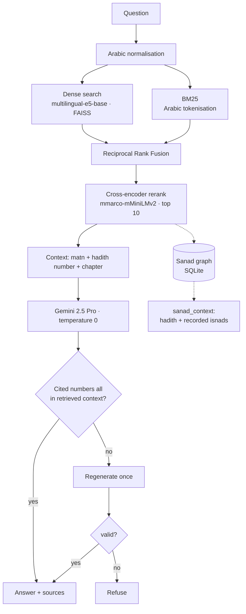

# مُسنَد · Musnad

**Grounded question answering over Sahih Muslim, with a transmission-chain (sanad) graph.**

Musnad answers questions about hadith from the source text, cites the exact hadith number, and refuses when the answer is not in the corpus. Behind the text search sits a graph of 14,155 ordered isnads, so a retrieved hadith can be traced narrator by narrator.

> «مُسنَد» بيجاوب على أسئلة من صحيح مسلم برقم الحديث ونص المتن، وبيرفض لما الإجابة مش موجودة في المصدر، وبيقدر يعرض سلسلة رواة الحديث اللي رجع.

<!-- DEMO: paste a real CLI run here (one answered question + one refusal),
     or a short GIF/asciinema recording. Do not write an example by hand. -->

---

## Highlights

- **Hybrid retrieval tuned by measurement.** Arabic-normalised BM25 + multilingual-e5 dense search, fused with Reciprocal Rank Fusion and reranked by a cross-encoder. Reranking raised MRR from 0.565 to **0.665** on the hand-verified set, and the full pipeline reaches **0.330 vs 0.189** for dense-only on a 224-query development set.
- **Citations enforced in code, not just requested in the prompt.** A hadith number outside the retrieved evidence triggers one regeneration, then a refusal. Invalid citation attempts: **0%**. Correct refusals on unanswerable questions: **3/3**.
- **Sanad graph.** 2,092 narrators, 63,642 ordered transmissions, 14,155 isnads in a deterministic SQLite build, joined to the local corpus through 7,015 verified hadith links.
- **Decisions backed by statistics.** The reranker was chosen with a paired McNemar test: no significant quality difference against a 17× larger model, at ~6× lower latency.
- **Negative results kept.** Four reasonable ideas (chapter-title prefixing, duplicate removal, fusion-weight tuning, CRAG self-correction) were measured, showed no gain, and were dropped.

---

## Architecture



The matn (text) is the retrieval unit; the isnad (chain) is served from the graph. Mixing the two in one embedding hurt retrieval, so they are kept apart.

---

## Results

Two evaluation sets with separate roles:

| Set | Size | Role |
|---|---|---|
| `golden.jsonl` | 33 hand-written, corpus-verified questions | reporting |
| `synthetic_eval.jsonl` | 224 generated known-item questions | configuration selection (development) |

**Retrieval, hand-verified set (n = 27)**

| Pipeline | hit@1 | hit@5 | hit@10 | MRR |
|---|---|---|---|---|
| Dense only | 41% | 59% | 63% | 0.493 |
| BM25 only | 33% | 63% | 67% | 0.464 |
| Hybrid (RRF) | 44% | 74% | 85% | 0.565 |
| **Hybrid + rerank** | **56%** | **81%** | 85% | **0.665** |

**Retrieval, development set (n = 224)**

| Pipeline | hit@1 | hit@5 | MRR |
|---|---|---|---|
| Dense only | 14% | 26% | 0.189 |
| Hybrid (RRF) | 18% | 37% | 0.256 |
| **Hybrid + rerank** | **27%** | **41%** | **0.330** |

The development questions are generated from random hadiths and are deliberately harder than the hand-written set, so absolute levels differ between the two; the ordering of configurations is the same on both.

**Answer quality (27 answerable + 3 unanswerable questions)**

| Metric | Hybrid | **Hybrid + rerank** |
|---|---|---|
| Correct citation | 70% | **81%** |
| Invalid citation attempts (measured before filtering) | 0% | **0%** |
| Cited a non-gold hadith from the context | 13% | **10%** |
| False refusals | 0% | **0%** |
| Correct refusals | 3/3 | **3/3** |

Improving retrieval translated directly into better answers: the reranker brought the gold hadith into context for two more questions and lifted correct citation by 11 points. Citation enforcement blocks citations outside the retrieved evidence; it does not by itself catch a wrong hadith chosen from within it — the claim-level verification on the roadmap targets that case. Full methodology, denominators and every experiment are in [`EXPERIMENTS.md`](EXPERIMENTS.md).

---

## Engineering decisions

| Decision | Why |
|---|---|
| Index without diacritics, display with them | Vocalised Arabic inflated e5 token counts 3.59× and broke words into characters |
| Fuse on ranks, not scores | BM25 and cosine scores live on different scales |
| Rerank the top 10, not 20 or 50 | Deeper candidate lists left hit@1 unchanged and lowered hit@5 |
| Small reranker (33M) over bge-m3 (568M) | McNemar: no significant difference; ~6× faster on CPU |
| Refuse instead of falling back to web search | In this domain an unsourced answer is worse than no answer |
| CRAG disabled by default | Measured: no change in correct citation, 3× the LLM calls |

---

## Sanad graph

| | |
|---|---|
| Narrators | 2,092 (stable, collision-free IDs) |
| Ordered transmissions | 63,642 |
| Isnads | 14,155 |
| Local hadiths linked to the graph | 7,015 of 7,459 |

Built deterministically from the MIS dataset into SQLite with a read-only query API (`src/sanad_graph.py`). Link quality between the local corpus and MIS was verified on the full population, not a sample: 7,004 exact unique matches plus 11 cases resolved by narrow, deterministic rules. Details in [`SANAD_GRAPH_READINESS.md`](SANAD_GRAPH_READINESS.md).

---

## Tech stack

| Layer | Choice |
|---|---|
| Embeddings | `intfloat/multilingual-e5-base` |
| Vector index | FAISS `IndexFlatIP` (exact search) |
| Lexical | BM25 with Arabic normalisation |
| Fusion | Reciprocal Rank Fusion |
| Reranker | `mmarco-mMiniLMv2-L12` |
| Generation | Gemini 2.5 Pro via Vertex AI |
| Graph store | SQLite |
| Tooling | Python 3.13, uv, pytest |

---

## Quickstart

```bash
uv sync
```

Generation uses Vertex AI with Application Default Credentials. Create `.env`:

```
GOOGLE_GENAI_USE_VERTEXAI=True
GOOGLE_CLOUD_PROJECT=your-project-id
GOOGLE_CLOUD_LOCATION=us-central1
```

```bash
gcloud auth application-default login

uv run python -m src.ingest && uv run python -m src.experiment_variants   # build the index
uv run python -m src.validate_golden && uv run python -m src.evaluate     # evaluate retrieval
uv run python -m src.smoke_test                                           # end-to-end check
uv run python -m src.answer                                               # answer data/raw/questions.txt
```

`uv run python -m src.check_docs` fails if any number in this README is not backed by `EXPERIMENTS.md`, or if an evaluation dataset changed without being re-measured.

---

## Project structure

```
src/
├── ingest.py, utils.py        # corpus → chunks, isnad/matn separation
├── embed.py, lexical.py       # dense and BM25 indexes, RRF
├── retrieve.py, rerank.py     # retrievers and cross-encoder
├── answer.py                  # grounded generation + citation enforcement
├── evaluate.py, answer_eval.py, validate_golden.py
├── build_sanad_graph.py, sanad_graph.py, sanad_context.py
└── experiment_*.py            # the comparisons behind EXPERIMENTS.md
tests/                         # graph build, linkage and data-audit tests
EXPERIMENTS.md                 # every number, with method and dataset hashes
```

---

## Roadmap

- **Agentic routing** — a router that sends text questions to the retrieval path and chain questions ("who transmitted this hadith?") to the sanad graph.
- **Claim-level verification** — structured answers where every claim carries its hadith ID and supporting quote, checked before the answer is returned.
- **Narrator disambiguation display** — when a name matches several historical narrators, show the candidates with their generation and source instead of choosing one.
- **Narrator gradings** (*al-jarḥ wa-l-taʿdīl*) — linked once narrator identity matching is validated by a domain specialist.
- **API and web demo** with request tracing.

---

## Scope

Musnad covers Sahih Muslim only. It is a research aid that surfaces recorded texts with their sources for a reader to verify; it does not issue religious rulings.
