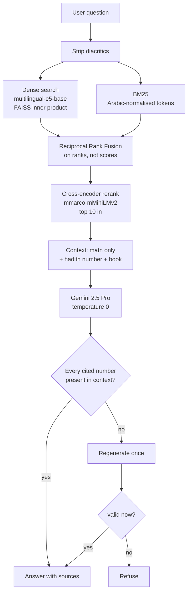

# مُسنَد · Musnad

**Grounded retrieval over Sahih Muslim.** Musnad answers questions from the corpus with the exact hadith number, refuses when the answer is not in the sources, and never cites a hadith it did not retrieve — every claim in this README is either measured or explicitly marked as not yet built.

> «مُسنَد» نظام بيجاوب على أسئلة من **صحيح مسلم** بمصدرها ورقم الحديث، وبيرفض صراحةً لما الإجابة مش موجودة في المصادر. الهدف النهائي إنه يتتبّع **سند** الحديث راوي راوي بحكم الجرح والتعديل. سلسلة السند نفسها مبنية دلوقتي من MIS، لكن **الجرح والتعديل لسه مش مربوط** — الرواة لسه ملهمش هوية تاريخية محسومة، وده موصوف تحت في [Planned](#planned).

---

## Status

| | |
|---|---|
| **Built and measured** | ingestion · isnād/matn separation · e5 embeddings · BM25 · hybrid RRF retrieval · cross-encoder reranking · grounded generation with enforced citations · two evaluation harnesses |
| **Built, disabled by default** | CRAG self-grading + one query rewrite — measured, no gain (see [`EXPERIMENTS.md`](EXPERIMENTS.md)) |
| **Built and measured** | MIS sanad chain graph — 2,092 narrator nodes, 14,155 ordered isnads, deterministic SQLite build with a read-only query API |
| **Not built yet** | narrator gradings · MIS↔Itqan identity resolution · agents/router · MCP server · web UI · tracing |

There is no UI and no agent layer yet. The system runs from the command line and is evaluated by scripts.

---

## What it does today



The index holds **7,110 documents** from 7,459 hadiths: one per hadith, minus 460 that are cross-references with no matn of their own, plus a small number of length-split parts.

---

## Results

Two evaluation sets, each with a distinct job:

- **`data/raw/golden.jsonl` — 33 hand-written, corpus-verified questions** (27 scored, 3 refusal tests, 3 narrator questions). The reporting set. `src/validate_golden.py` gates every run: each cited hadith id must exist, the quoted matn must actually appear in one of them, and refusal questions' key terms must be genuinely absent from the corpus.
- **`data/raw/synthetic_eval.jsonl` — 224 generated known-item questions**, used *only* for choosing between configurations, where a 2-point difference on 27 questions is a single question and therefore noise.

**Retrieval** (golden set, n=27):

| Stage | hit@1 | hit@3 | hit@5 | hit@10 | MRR |
|---|---|---|---|---|---|
| Dense only | 41% | 56% | 59% | 63% | 0.493 |
| BM25 only | 33% | 59% | 63% | 67% | 0.464 |
| Hybrid (RRF) | 44% | 67% | 74% | 85% | 0.565 |
| **Hybrid + reranking** | **56%** | **74%** | **81%** | 85% | **0.665** |

**Answer quality** (30 questions: 27 answerable + 3 refusal tests). All metrics are computed programmatically. Invalid-citation attempts are measured on the raw model output *before* filtering — measuring them afterwards would return zero by construction and mean nothing.

| | Hybrid | **Hybrid + reranking** |
|---|---|---|
| Invalid citation attempts | 0% | **0%** |
| Correct citation | 70% | **81%** |
| Cited the wrong hadith from context | 13% | **10%** |
| False refusal (the answer was in context) | 0% | **0%** |
| Correct refusal on unanswerable questions | 3/3 | **3/3** |

Narrator questions ("who transmitted this, and how was each one graded?") score **0%** and are excluded from the tables above: they are structurally unanswerable from text. The chain half of that gap is now closed by the MIS sanad graph, which can return an ordered isnad; the grading half is not, because narrator identity is unresolved.

[`EXPERIMENTS.md`](EXPERIMENTS.md) is the single source of truth for every number, including four negative results, three falsified hypotheses, and the significance tests behind each decision.

---

## Design decisions

**The matn is the retrieval unit.** Documents are indexed on the matn with the isnād stripped; the chain of transmitters is noise against a question about meaning. Three representations were compared — matn only, isnād+matn, chapter-title+matn — and matn only won on both evaluation sets. Hadiths longer than the token budget are split by length, which affects a small minority; nothing is split at a fixed character window.

**Index without diacritics, display with them.** The e5 tokeniser shatters vocalised Arabic into single characters — 3.59× the token count, with no word-level units left. Search runs on the stripped text; the answer renders the original vocalised matn.

**Fuse on ranks, not scores.** BM25 scores and cosine similarities are not on a common scale, so Reciprocal Rank Fusion combines the two orderings instead of their values.

**Rerank the top 10, not the top 20.** `hit@10`, `hit@20` and `hit@50` are all identical at 89% — a deeper candidate list buys nothing but latency.

**Citation validity is enforced in code, not requested in the prompt.** Any hadith number absent from the retrieved context triggers one regeneration; if it fails again the system refuses. It does not silently drop the number — an answer without a source is worse here than an admission of ignorance.

**Refusal over fallback.** There is deliberately no web-search escape hatch. When the answer is not in the approved sources the system says so.

**Every configuration change is measured before it is kept.** Four ideas that seemed reasonable were dropped after measurement showed no gain: chapter-title prefixing, duplicate-matn removal, candidate-pool and RRF-weight tuning, and CRAG self-correction.

---

## Tech stack

| Layer | Choice |
|---|---|
| Embeddings | `intfloat/multilingual-e5-base` |
| Vector index | FAISS `IndexFlatIP` over L2-normalised vectors (exact search; 7,110 documents does not need an approximate index) |
| Lexical retrieval | BM25 with Arabic normalisation (diacritics, alef/ya/ta-marbuta, definite article) |
| Fusion | Reciprocal Rank Fusion |
| Reranking | `mmarco-mMiniLMv2-L12` — chosen over `bge-reranker-v2-m3` (17× larger) after a paired McNemar test found no significant difference and a 6× speed gap |
| Generation | Gemini 2.5 Pro via Vertex AI |

`src/chroma_ingest.py` loads the same vectors into ChromaDB. It is a working alternative store that the query path does **not** go through — retrieval uses FAISS.

---

## Data

| Path | Contents | Status |
|---|---|---|
| `data/raw/muslim.json` | Sahih Muslim — 57 books, 7,459 hadiths, Arabic text with bilingual metadata | present |
| `data/raw/golden.jsonl` | 33 hand-verified evaluation questions | present |
| `data/raw/synthetic_eval.jsonl` | 224 generated evaluation questions | present |
| `data/processed/` | chunks, embeddings, id lists | generated, git-ignored |
| Narrator chains (MIS) and Itqan *rijal* profiles | present locally under `data/raw/external/`, git-ignored; acquisition/provenance in [`DATA_SOURCES.md`](DATA_SOURCES.md) | **MIS chain graph built; entity resolution not** |
| `data/processed/sanad_graph.sqlite` | MIS chain graph — narrators, hadiths, isnads, ordered transmissions | generated, git-ignored |

Record shape of the corpus:

```jsonc
{
  "id": 2,
  "metadata": { "arabic": { "title": "صحيح مسلم", "author": "..." }, "english": { ... } },
  "chapters": [ { "id": 1, "arabic": "كتاب الإيمان", "english": "The Book of Faith" }, ... ],
  "hadiths":  [ { "id": 7278, "idInBook": 1, "chapterId": 1, "arabic": "حَدَّثَنِي أَبُو خَيْثَمَةَ، ..." }, ... ]
}
```

---

## Project structure

```
sanad/
├── data/raw/                 # corpus + evaluation sets
├── data/processed/           # generated, git-ignored
├── src/
│   ├── config.py             # all paths; each vectors file pairs with an ids file
│   ├── utils.py              # diacritics, isnād/matn separation, chunking
│   ├── ingest.py             # corpus → chunks, flags cross-reference-only entries
│   ├── embed.py              # e5 embeddings
│   ├── lexical.py            # Arabic BM25 + reciprocal rank fusion
│   ├── retrieve.py           # dense / lexical / hybrid retrievers
│   ├── rerank.py             # cross-encoder reranking
│   ├── answer.py             # grounded generation, citation enforcement, CRAG
│   ├── evaluate.py           # retrieval metrics over either eval set
│   ├── answer_eval.py        # answer-error metrics
│   ├── validate_golden.py    # gate: verifies the ground truth itself
│   ├── build_eval_set.py     # generates the 224-question set
│   ├── chroma_ingest.py      # alternative store, not on the query path
│   └── experiment_*.py       # the comparisons behind EXPERIMENTS.md
├── EXPERIMENTS.md            # single source of truth for every number
└── main.py
```

---

## Getting started

Requires Python 3.13 and [uv](https://docs.astral.sh/uv/).

**1. Install**

```bash
uv sync
```

**2. Authenticate** — generation runs on Vertex AI, which uses Application Default Credentials rather than an API key. Create a `.env`:

```
GOOGLE_GENAI_USE_VERTEXAI=True
GOOGLE_CLOUD_PROJECT=your-project-id
GOOGLE_CLOUD_LOCATION=us-central1
```

```bash
gcloud auth application-default login
```

**3. Build the index** — ingest, then build the three representation variants:

```bash
uv run python -m src.ingest && uv run python -m src.experiment_variants
```

**4. Evaluate** — the ground-truth validator runs first as a gate:

```bash
uv run python -m src.validate_golden && uv run python -m src.evaluate
```

**5. Smoke-test the pipeline** — imports, index, retrieval, reranking, one grounded answer, one refusal:

```bash
uv run python -m src.smoke_test
```

**6. Ask questions** — runs the pipeline over `data/raw/questions.txt`:

```bash
uv run python -m src.answer
```

Answer-error metrics (this one calls the model, so it costs quota):

```bash
uv run python -m src.answer_eval
```

### Keeping the docs honest

[`EXPERIMENTS.md`](EXPERIMENTS.md) is the single source of truth for every number, and it records the sha256 of each evaluation dataset. This check fails if a README number is not backed by `EXPERIMENTS.md`, or if a dataset changed without the numbers being re-measured:

```bash
uv run python -m src.check_docs
```

---

## Planned

None of the following is built. It is recorded here because it is the point of the project, not because it exists.

The chain layer is the one piece that has since been built — see
[`SANAD_GRAPH_READINESS.md`](SANAD_GRAPH_READINESS.md) and EXPERIMENTS §17. It answers
chain-structure questions as recorded in MIS and deliberately answers nothing about
narrator identity or reliability.

- **Narrator gradings on the graph** — *al-jarḥ wa-l-taʿdīl* attached to a narrator, kept source-specific so conflicting verdicts stay visible. Blocked: it needs an adjudicated MIS↔Itqan identity that does not exist.
- **Isnād tracing with gradings** — the ordered chain is available today; returning each narrator's grading with its source is not, and the graph abstains rather than guessing.
- **Ambiguity display** — when a narrator name matches several people, listing the candidates with their *ṭabaqa* instead of silently picking one.
- **Router and two agents** — a matn agent and a sanad agent behind a classifier, orchestrated as a state machine.
- **Metadata filtering** — book/chapter constraints applied at retrieval time.
- **MCP server** — exposing `search_hadith` and `check_sanad` as tools.
- **Web UI and request tracing.**

The immediate next retrieval step is query expansion: three questions in the golden set are not retrievable by any method at any depth, and their ground truth has been verified as correct, so the failure is a genuine vocabulary gap rather than a bad question.

---

## Scope and limitations

Musnad is a **research assistance tool**. It surfaces recorded statements together with their sources so a human can verify them. It does not issue rulings and is not a fatwa authority.

Coverage is limited to Sahih Muslim. Retrieval finds the right hadith in the top 5 for 81% of the hand-verified questions, so roughly one question in five is answered from an incomplete context — the system's refusal behaviour is what keeps that from becoming a fabricated answer.
